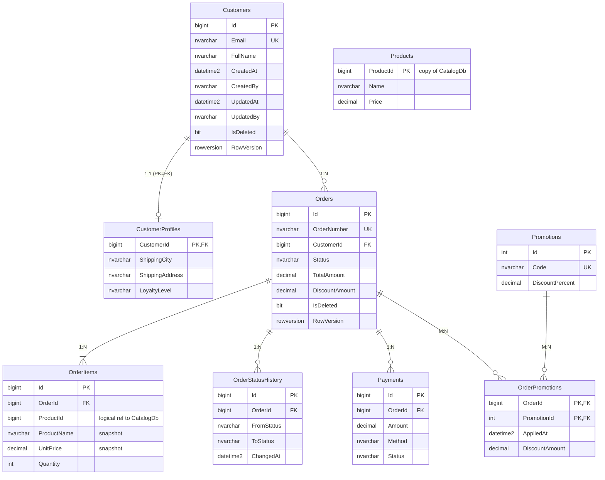
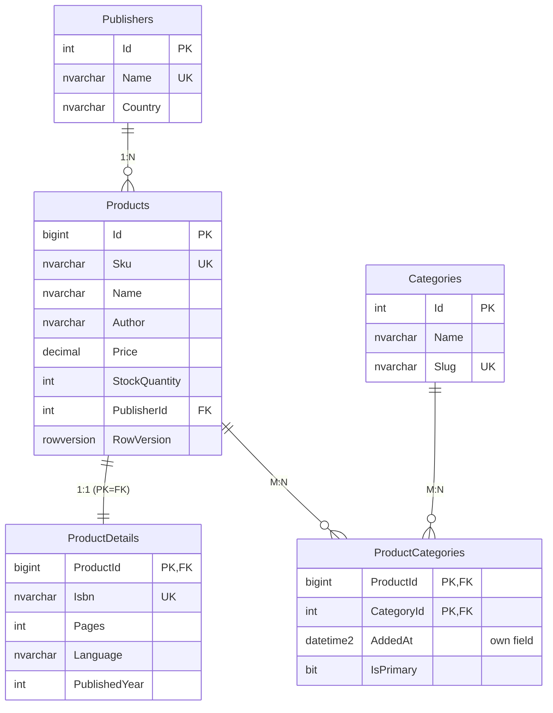
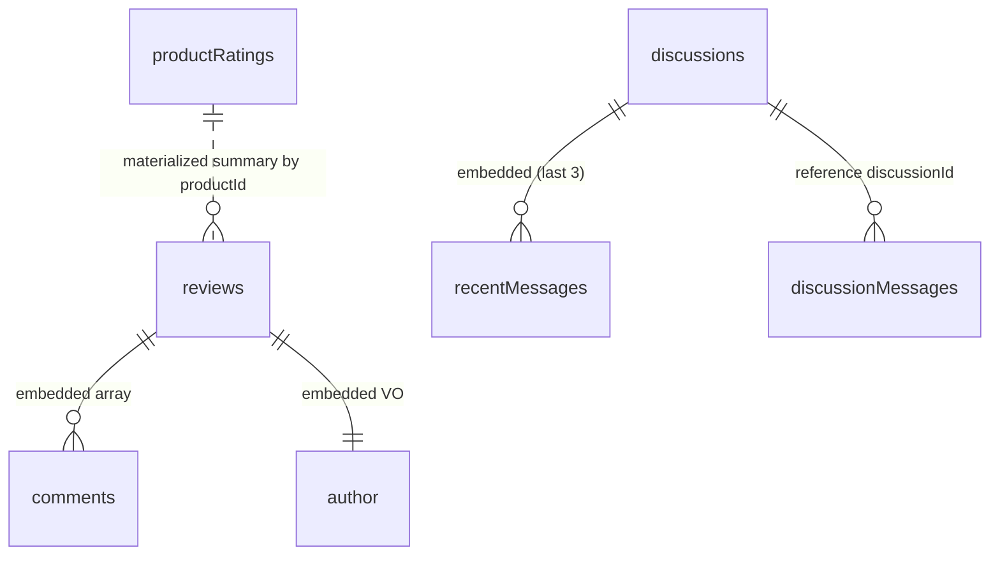

# ERD-діаграми

Суцільні лінії — FOREIGN KEY усередині однієї бази. Між базами зв'язків FK немає:
`OrderItems.ProductId`, `Products.ProductId` (OrdersDb) і `reviews.productId` (ReviewsDb) — логічні посилання на `CatalogDb.Products.Id`.

## Проєкт №1 — OrdersDb (SQL Server, ADO.NET + Dapper)



## Проєкт №2 — CatalogDb (SQL Server, EF Core)



## Проєкт №3 — ReviewsDb (MongoDB)



Приклад документа `reviews` (тип `pros-cons`):

```json
{
  "_id": { "$oid": "6650a1f2c1e4b2a1d0f00001" },
  "productId": 3,
  "productName": "Clean Code",
  "type": "pros-cons",
  "author": { "userId": "u-taras", "displayName": "Тарас Б." },
  "rating": { "value": 4 },
  "title": "Класика для розробника",
  "pros": ["Практичні приклади"],
  "cons": ["Приклади на Java"],
  "comments": [],
  "helpfulVotes": 0,
  "createdAt": "2026-11-20T10:00:00Z",
  "version": 1
}
```
